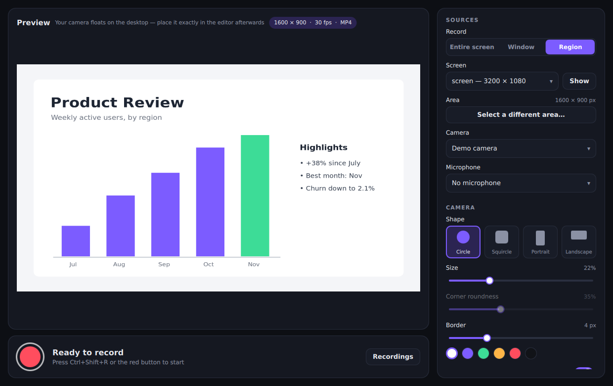
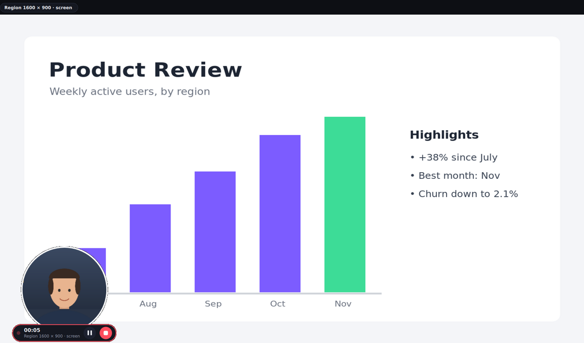
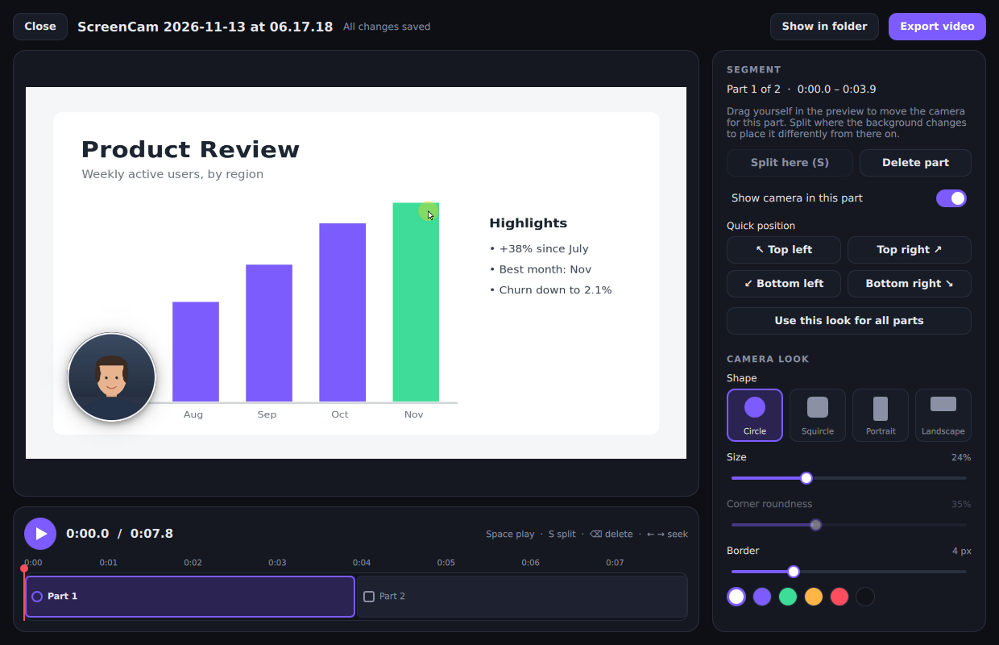

# ScreenCam

Record your screen with yourself in a floating camera bubble — and move the bubble around
**after** recording, so you never hide what you're showing.

Runs on macOS, Windows and Linux (C++20 · Qt 6 / QML · CMake).



## What it does

- Records a **whole screen, one app window, or a region** you draw — together with your camera.
- Your camera floats on the desktop as a **bubble** you can drag anywhere (any monitor). Pick its
  shape, size, border and shadow.
- **Pause / stop** right from the bubble while you record. A small tag shows what's being recorded.
- The **mouse pointer** is always in the video, with an optional highlight to point things out.
- ScreenCam's own windows never show up in the recording.
- Afterwards, **edit** where the bubble sits over time, then **export** an MP4.

## Recording



1. Choose what to record (screen, window or region), your camera and microphone.
2. Press the red button (or **⌘⇧R** / **Ctrl+Shift+R**). ScreenCam steps aside.
3. Stop from the bubble. The editor opens with your recording.

## Editing



- Drag yourself in the preview to place the camera — for the part under the playhead.
- Press **S** to split where the background changes, then place yourself differently there.
- Change the bubble's look per part, or hide the camera for a part.
- **Export video** writes `<name>.mp4` next to the recording.

Every recording is a `.screencam` project (your screen, your camera and your edits). Reopen one
from **Recordings** in the main window, or double-click it in Finder.

## Install

You need **Qt 6.8+ with Qt Multimedia's FFmpeg backend** (the Qt Online Installer includes it),
**CMake 3.25+**, **Ninja** and a C++20 compiler.

**macOS**

```bash
scripts/create-macos-signing-identity.sh   # once: keeps camera/screen permissions across builds
scripts/install.sh                         # builds and installs ~/Applications/ScreenCam.app
```

Then open ScreenCam from Spotlight or Launchpad. The install step takes a few minutes.
If your Qt was built from source without FFmpeg, run `scripts/build-qt-ffmpeg.sh` first.

**Linux**

```bash
scripts/install.sh        # installs into ~/.local (app menu entry included)
```

**Windows** (x64 Native Tools prompt)

```bat
cmake --preset release -DCMAKE_PREFIX_PATH=C:/Qt/6.8.3/msvc2022_64
cmake --build --preset release
cmake --install build/release --prefix "%LOCALAPPDATA%/Programs/ScreenCam"
```

Video export needs the FFmpeg development files; CMake finds the ones from
`scripts/build-qt-ffmpeg.sh` on its own, otherwise pass `-DFFMPEG_DIR=<ffmpeg folder>`.

## Development

```bash
cmake --preset default && cmake --build --preset default   # Debug build in build/
ctest --preset default                                     # tests (run headless)
```

`SCREENCAM_DEMO_CAMERA=picture.png` adds a stand-in camera for machines without a webcam.

Debug builds reload the UI when you save a `.qml` file (the terminal shows `[hot reload] reloaded`,
or the error to fix); C++ changes still need a rebuild.

## Troubleshooting

- **Black preview / "built without the FFmpeg backend"** — your Qt lacks Qt Multimedia's FFmpeg
  plugin. Use Qt from the Online Installer, or `scripts/build-qt-ffmpeg.sh`.
- **macOS keeps asking for Screen Recording** — allow ScreenCam in *System Settings ▸ Privacy &
  Security ▸ Screen & System Audio Recording*, then quit (⌘Q) and reopen it.
- **Linux** — apps can't hide their own windows from a screen recording there; record a window
  or a region next to ScreenCam instead.
